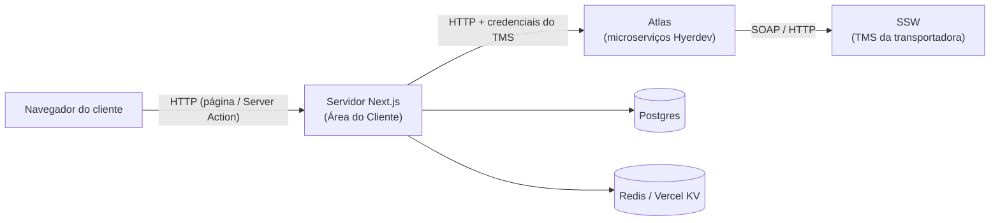
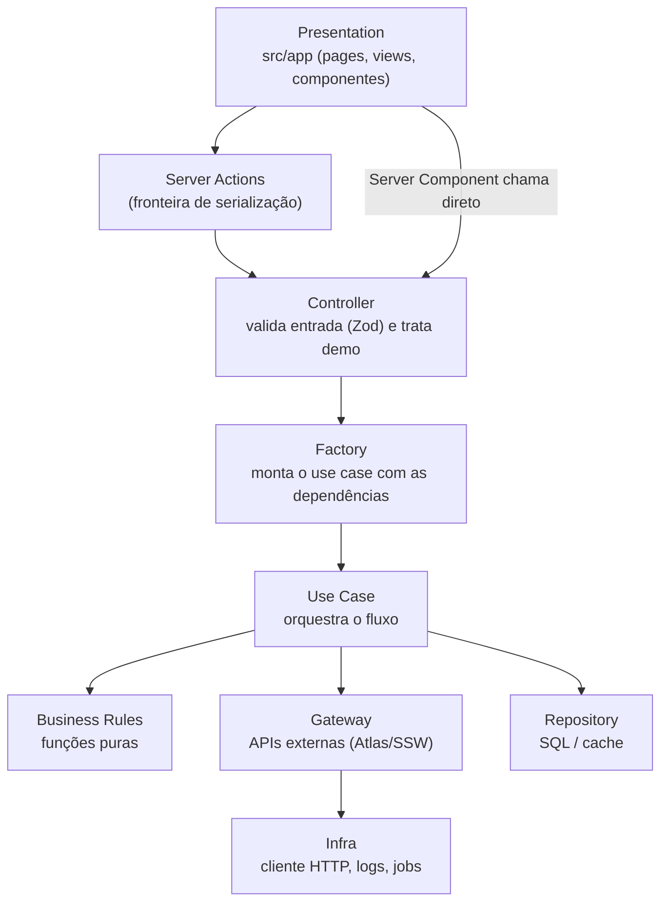
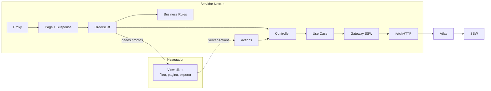

# Arquitetura e comunicação entre camadas: Área do Cliente

> Guia de estudo, sem código. O exemplo que acompanha o texto todo é a tela **/rastrear** (lista de encomendas).

---

## 1. Como ver o sistema

A Área do Cliente é um **app Next.js (App Router)** que faz o papel de **BFF (Backend for Frontend)**. O navegador do cliente **nunca fala direto** com a API de rastreamento. Quem fala com ela é o **servidor do Next.js**, e o resultado volta pronto para a tela.



- **SSW** é o TMS (sistema de gestão de transporte) onde de fato estão os CT-es, as ocorrências e as entregas.
- **Atlas** é uma camada intermediária (microserviços internos) que traduz o SSW, muitas vezes antigo e em SOAP/XML, para JSON amigável.
- **Área do Cliente** consome o Atlas, aplica as regras de negócio do produto e renderiza a tela.
- **Postgres** guarda dados próprios: usuários, empresas, eventos, histórico. **Redis/KV** guarda cache e preferências.

**Por que assim?** As credenciais do SSW de cada transportadora (usuário, senha, domínio) e os tokens do Atlas **não podem chegar ao navegador**. Deixar tudo no servidor resolve isso de forma natural.

---

## 2. Multi-tenant: "qual transportadora é essa?"

O mesmo código atende várias transportadoras. Cada uma tem seu domínio, cores, SEO e **credenciais do TMS**.

1. A requisição chega e passa pelo **proxy/middleware** (`src/proxy.ts`). Ele descobre o *tenant* pelo host, reescreve a rota para `/[tenant]/...`, confere se a rota é privada (o `rastrear` é), se há sessão, se o usuário está aprovado e se o plano da empresa libera aquela seção.
2. Já dentro da página, `getCompanyByDomain()` devolve a **empresa pública** (tema, SEO, flags). `getCompanyPrivateByDomain()` devolve a **empresa privada** (credenciais do TMS), que só existe no servidor.

Pense no tenant como um **contexto que viaja junto** por todas as camadas: quase todo controller/use case recebe `company` ou `companyPrivate`.

---

## 3. As camadas (Clean Architecture)

A regra de ouro: **dependências apontam para dentro**. A UI conhece o core; o core não conhece React nem Next.



| Camada | Pergunta que ela responde | Onde fica |
|---|---|---|
| **Page (Server Component)** | "O que essa rota precisa para renderizar?" | `src/app/[tenant]/.../page.tsx` |
| **View / componente client** | "Como mostrar e interagir?" | `*.view.tsx`, `'use client'` |
| **Server Action** | "Como o navegador pede algo ao servidor depois que a página já carregou?" | `core/domain/<módulo>/actions/` |
| **Controller** | "A entrada é válida? É ambiente demo?" | `controllers/*.controller.ts` |
| **Factory** | "Com quais implementações reais esse caso de uso roda?" | `factories/` |
| **Use Case** | "Qual é o passo a passo da operação?" | `use-cases/` |
| **Business Rule** | "Qual é a regra? (cálculo/decisão pura, sem I/O)" | `business-rules/` |
| **Gateway** | "Como falar com um sistema externo?" | `core/domain/tms/...` |
| **Repository** | "Como ler/gravar no nosso banco ou cache?" | `repository/` |
| **Infra** | "Ferramentas técnicas: HTTP, timeout, logs, filas" | `core/infra/` |

### Conceitos que amarram tudo

- **Either (Railway-Oriented):** nenhuma camada lança erro para cima. Toda função devolve *sucesso* ou *falha* (com `status` e `message`). O erro anda "nos trilhos" até a borda, onde alguém decide o que fazer (redirect, toast, mensagem).
- **Injeção de dependência por currying:** o use case recebe dependências (gateway, repositório) na criação, e só depois recebe o input. Nos testes você troca o gateway real por um falso sem mexer no use case.
- **Strategy para o TMS:** existe um contrato genérico de TMS e uma implementação `ssw`. A `TMSFactory` é um mapa *tipo de TMS → implementação*. Se amanhã entrar outro TMS, nasce outra estratégia e o restante continua igual.
- **Server Actions finas:** a action só faz a ponte (sessão, chamar controller, converter Either em objeto simples `{ error: true/false, ... }`). Lógica nunca mora ali.

---

## 4. Passo a passo: abrindo `/rastrear/remetente`

```mermaid
sequenceDiagram
    participant U as Navegador
    participant MW as Proxy (middleware)
    participant PG as Page rastrear
    participant OL as OrdersList (Server Component)
    participant C as Controller
    participant UC as Use Case
    participant GW as Gateway SSW (Strategy)
    participant H as Cliente HTTP (infra)
    participant AT as Atlas
    participant SSW as SSW

    U->>MW: GET /rastrear/remetente
    MW->>MW: resolve tenant, checa sessão, aprovação e plano
    MW->>PG: rewrite /[tenant]/rastrear/...
    PG->>PG: empresa + sessão em paralelo, valida tipo
    PG->>OL: renderiza dentro de Suspense (mostra loading)
    OL->>C: listOrders(document, tipo, datas, group, companyPrivate)
    C->>C: valida com Zod; se tenant demo, devolve JSON fake
    C->>UC: segue para o caso de uso (via factory)
    UC->>GW: um pedido para cada login de TMS da empresa (em paralelo)
    GW->>H: GET Atlas /ssw/rastreamento/list-orders
    H->>AT: headers com domínio/usuário/senha + token, timeout, cache
    AT->>SSW: consulta o TMS
    SSW-->>AT: dados brutos
    AT-->>H: JSON de encomendas
    H-->>GW: Either
    GW-->>UC: Either por login
    UC->>UC: junta as listas e soma os totais; registra evento se vier de relatório
    UC-->>C: Either
    C-->>OL: Either
    OL->>OL: business rules (atraso, situação, máscara, deep search)
    OL-->>U: HTML/RSC com a TableOrderView (client) já hidratada
```

### O que acontece em cada parada

1. **Proxy:** primeira barreira de segurança e roteamento multi-tenant.
2. **Page:** busca empresa e sessão em paralelo, valida o segmento `tipo` (remetente, destinatário ou pagador), mostra a tela de "aguardando aprovação" quando for o caso e envolve a lista num **Suspense**. A `key` do Suspense muda junto com os filtros, então trocar o período mostra o loading de novo.
3. **OrdersList (Server Component):** é o "orquestrador da tela". Lê as credenciais privadas, normaliza as datas, decide o modo de agrupamento por CNPJ, busca as preferências da tabela e as ocorrências (análise apurada) **somente se** o usuário tiver permissão, e chama o controller de listagem.
4. **Controller:** valida a entrada. Se o tenant for **demo**, responde com um mock e **não toca no TMS**.
5. **Use Case:** uma empresa pode ter **vários logins de TMS** (principal + adicionais). O use case dispara todos em paralelo, tolera falha parcial (basta um dar certo), junta as listas e devolve um único resultado.
6. **Gateway (SSWGatewayStrategy):** sabe o "dialeto" do Atlas: URL, headers de autenticação, parâmetros (documento, tipo, período, flags de atraso/pendência) e política de cache.
7. **Cliente HTTP (infra):** wrapper do `fetch`. Cuida de timeout (aborta a requisição), log com URL sanitizada (sem senha) e repassa `revalidate`/`tags` para o cache do Next. Devolve Either.
8. **Volta:** o Either sobe. Em caso de falha, a tela mostra estado de erro; em caso de sucesso, as **business rules** de apresentação (atrasos, situação reclassificada, ocultar o que o cliente não pode ver) rodam ainda no servidor.
9. **View client (`TableOrderView`):** recebe dados prontos e serializáveis. Busca, filtros, paginação, colunas visíveis e exportação de CSV acontecem **no navegador**, sem nova ida à API.

---

## 5. Os dois caminhos do front até o servidor

| Caminho | Quando | Exemplo no rastreio |
|---|---|---|
| **Server Component chama controller direto** | Carga inicial da página (leitura) | Listar as encomendas |
| **Server Action** (`'use server'`) | Interação depois do carregamento (mutação ou leitura sob demanda) | Salvar preferências da tabela, agendar entrega, baixar DACTE/XML, forçar a atualização da lista |
| **API Route** (`src/app/api/**`) | Consumidores externos ou fora do React: webhooks, integrações, MCP, ETL, OAuth | Não é usada pela tela de rastreio |

Repare: **não há um `fetch('/api/rastreamento')` no navegador**. O "contrato" entre front e back é a própria assinatura da Server Action ou do controller, e o Next cuida do transporte.

---

## 6. Cache: por que às vezes o dado "não muda"

- Listagem **sem agrupamento**: o gateway pede ao Next para guardar a resposta do Atlas por **1 hora** (`revalidate`).
- Listagem **agrupada por CNPJ**: `no-store`, sempre fresca.
- Existem **tags** de cache (por exemplo, a lista recente por usuário + documento). Uma Server Action como "atualizar lista" chama `revalidateTag`/`revalidatePath` para invalidar e forçar uma nova consulta.
- Preferências da tabela vão para cache/KV, não para o SSW.

---

## 7. Observabilidade e segurança no caminho

- **Logs (Axiom):** a tela registra início/fim de renderização com tenant, usuário e rota. O cliente HTTP registra as chamadas externas com URL e parâmetros **sanitizados**.
- **Credenciais:** vivem só na "empresa privada" e nos headers server→Atlas. O navegador nunca as recebe.
- **Autorização:** em camadas. O proxy cuida de rota, sessão e plano; a page cuida da aprovação; as business rules decidem permissões finas (colaborador vs. cliente, deep search, atrasos visíveis).
- **Timeout longo** (4 min) nessa chamada, porque o SSW pode ser lento com períodos grandes. A página também declara `maxDuration` maior.

---

## 8. Mapa mental resumido



**Frase para guardar:** *o navegador só desenha; o servidor Next decide e busca; o Atlas traduz; o SSW é a fonte da verdade.*

---

## 9. Para estudar no próprio código (nesta ordem)

1. `src/proxy.ts`: entrada, tenant e proteção de rotas
2. `src/app/[tenant]/(left-nav-bar)/rastrear/[...data]/page.tsx`
3. `.../rastrear/[...data]/_components/orders-list.component.tsx`
4. `core/domain/orders/controllers/list-orders-by-CPF-or-CNPJ-loggedIn.controller.ts`
5. `core/domain/orders/factories/order-gateway.factories.ts`
6. `core/domain/orders/use-cases/list-orders-by-CPF-or-CNPJ-loggedIn.ts`
7. `core/domain/tms/factory.ts` → `core/domain/tms/ssw/gateways/ssw.strategy.gateway.ts`
8. `core/infra/http/fetchHTTP.ts`
9. Documentação de apoio: `.agent/docs/ARCHITECTURE.md`, `core/domain/orders/README.md`, `core/domain/tms/README.md`
